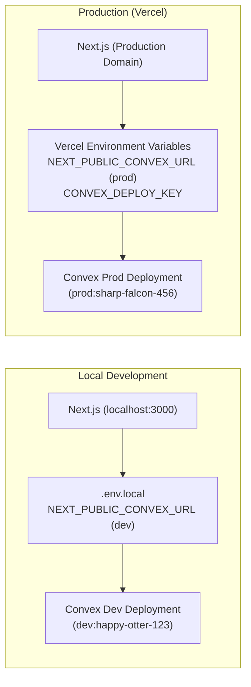

# Convex Migration & Multi-Environment Architecture Plan

This document outlines the end-to-end plan to migrate **Ente Vaahanam** from Supabase to **Convex**, with isolated **Development** and **Production** environments.

---

## 1. Architecture Comparison & Mapping

| Feature | Current (Supabase) | New (Convex) |
| :--- | :--- | :--- |
| **Database** | PostgreSQL with relational tables & SQL constraints | Document-relational database with TypeScript schema validation (`defineSchema`, `defineTable`) |
| **Authentication** | Supabase Auth (`@supabase/ssr` + Google OAuth) | Convex Auth (`@convex-dev/auth` + `@auth/core` Google Provider) |
| **Authorization** | PostgreSQL Row-Level Security (`auth.uid() = user_id`) | Convex function guards via `getAuthUserId(ctx)` |
| **API & Queries** | Direct SQL / Supabase REST SDK in Server Actions | Type-safe queries & mutations (`query`, `mutation`) with automatic real-time updates |
| **Cron / Reminders** | `/api/cron` route invoked via external cron trigger | Native Convex Cron (`convex/crons.ts`) running scheduled mutations internally |
| **Push Notifications** | `web-push` in Next.js API route reading Postgres | Convex action (`action`) with `web-push` querying subscription records |

---

## 2. Multi-Environment Setup (Dev & Prod)

Convex provides built-in isolation between Development and Production deployments per project.



### Environment Isolation Rules:
1. **Database & Storage**: Completely isolated data. Records created in `dev` never touch `prod`.
2. **Environment Variables & Secrets**:
   - Google OAuth credentials (`AUTH_GOOGLE_ID`, `AUTH_GOOGLE_SECRET`) are configured separately:
     - Dev: configured with `http://localhost:3000` redirect URI.
     - Prod: configured with production domain redirect URI.
   - Web Push keys (`VAPID_PUBLIC_KEY`, `VAPID_PRIVATE_KEY`, `VAPID_SUBJECT`) can be set independently using:
     - `npx convex env set KEY value` (applies to dev)
     - `npx convex env set KEY value --prod` (applies to prod)
3. **Cron Jobs**:
   - Active on `prod` deployment automatically.
   - Can be triggered manually or run in `dev` for testing without affecting production users.

---

## 3. Phased Implementation Steps

### Phase 1: Convex Initialization & Authentication Setup
1. **Install Dependencies**:
   - `convex`, `@convex-dev/auth`, `@auth/core`
2. **Initialize Convex**:
   - Run `npx convex dev` to link/create the Convex project.
   - This provisions the Dev deployment and generates `.env.local` + `convex/_generated/`.
3. **Configure Convex Auth**:
   - Create `convex/auth.ts` configuring Google Provider.
   - Create `convex/http.ts` for auth routing.
   - Wrap Next.js app with `ConvexAuthNextjsServerProvider` in `src/app/layout.tsx`.
   - Update `src/app/login/GoogleButton.tsx` and auth callback handling.

### Phase 2: Schema Definition (`convex/schema.ts`)
Define strongly typed tables replacing `supabase/migrations/0001_init.sql`:
- **`vehicles`**:
  - `userId`: `v.id("users")` (indexed by `by_user`)
  - `name`, `make`, `model`, `year`, `plateNumber`, `odometer`, `distanceUnit`, `createdAt`
- **`serviceRecords`**:
  - `userId`: `v.id("users")` (indexed by `by_user`)
  - `vehicleId`: `v.id("vehicles")` (indexed by `by_vehicle_and_date`)
  - `type`, `customLabel`, `doneOn`, `odometer`, `cost`, `notes`
  - Reminder fields: `remindOn`, `remindAtOdometer`, `reminderState`, `reminderClosedAt`, `lastNotifiedStage`, `lastNotifiedAt`, `createdAt`
- **`pushSubscriptions`**:
  - `userId`: `v.id("users")` (indexed by `by_user` and `by_endpoint`)
  - `endpoint`, `p256dh`, `auth`, `createdAt`

### Phase 3: Convex Queries & Mutations
Convert current Supabase queries in `src/app/actions.ts` into Convex functions:
- `convex/vehicles.ts`: `listVehicles`, `getVehicle`, `createVehicle`, `updateVehicle`, `deleteVehicle`, `updateOdometer`
- `convex/records.ts`: `listRecordsByVehicle`, `createRecord`, `updateRecord`, `deleteRecord`, `dismissReminder`
- `convex/subscriptions.ts`: `saveSubscription`, `deleteSubscription`
- Every function verifies `const userId = await getAuthUserId(ctx);` ensuring strict user isolation.

### Phase 4: Cron Jobs & Reminders Migration
- Move logic from `src/app/api/cron/route.ts` into Convex:
  - Create `convex/crons.ts` running a daily scheduled function.
  - Create `convex/notifications.ts` action to compute due reminders and dispatch Web Push notifications using `web-push`.
  - Delete the unneeded `/api/cron` route and Vercel Cron token configuration.

### Phase 5: Frontend Component Adaptation
- Update vehicle list, vehicle detail, and service history pages to use Convex hooks (`useQuery`, `useMutation`) or server-side preloading via `fetchQuery`.
- Replace manual revalidation paths (`revalidatePath`) with Convex's reactive state (UI updates immediately when database updates).

### Phase 6: Multi-Environment Deployment & Production Setup
1. **Set Production Secrets**:
   ```bash
   npx convex env set AUTH_GOOGLE_ID <prod-id> --prod
   npx convex env set AUTH_GOOGLE_SECRET <prod-secret> --prod
   npx convex env set VAPID_PUBLIC_KEY <prod-key> --prod
   npx convex env set VAPID_PRIVATE_KEY <prod-key> --prod
   ```
2. **Deploy Production**:
   - Run `npx convex deploy` or link with Vercel by adding `CONVEX_DEPLOY_KEY` and `NEXT_PUBLIC_CONVEX_URL` to Vercel production settings.
3. **Data Migration (Optional)**:
   - If there is existing live data in Supabase:
     - Run a script to dump Supabase tables to `.jsonl`.
     - Import into Convex using `npx convex import --table <tableName> <file.jsonl>`.

### Phase 7: Deprecation & Cleanup
- Uninstall `@supabase/supabase-js` and `@supabase/ssr`.
- Remove `src/lib/supabase/` and old migration SQL files.
- Clean up unused environment variables.

---

## 4. Key Decisions & Questions

1. **Existing Data Migration**: Do you currently have production user/vehicle data in Supabase that must be imported into Convex, or is it acceptable to start fresh with a clean database?
2. **Hosting Provider**: Are you deploying to **Vercel** or another platform (Render, Netlify, VPS)?
3. **Google OAuth Credentials**: Do you already have a Google Cloud Console project configured where we can add the Convex redirect URLs, or should we set up a new one?

